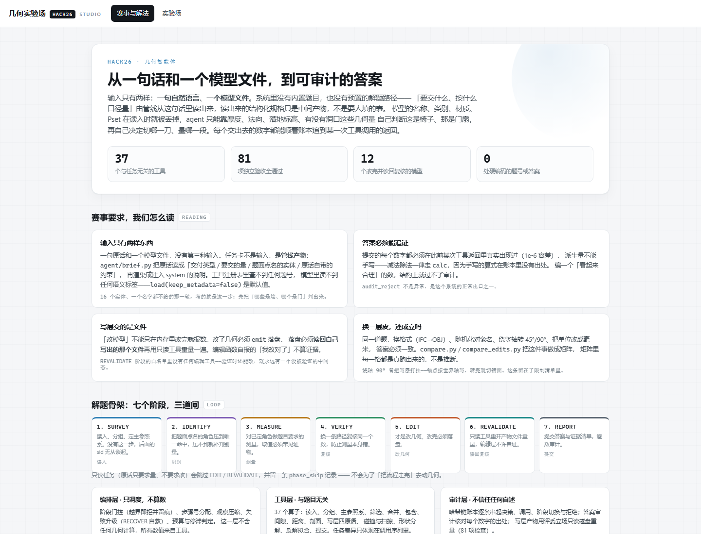
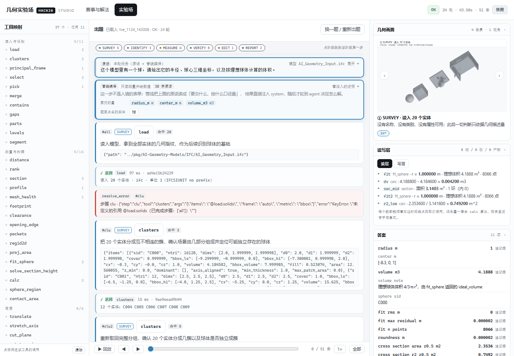

# AIGeoLab · AI 几何沙盒（Geometry Sandbox）

> 给智能体一张任务卡和一个模型文件，它自己观察、自己选工具、自己判断证据够不够、自己提交并接受审计。
> 仓库里**没有针对某道题写的代码**：题目只以文本存在，判断只以决策记录存在，数值只由几何内核产生。

参赛作品覆盖 **10 题全部**（Task 01 的四小问都做了答案：位置关系、三距离、门扇夹角、绕角旋转 90° 重算）：

- **读**（只交数字，不交文件）：
  - Task 01 第 1 问 —— 椅子占地中心相对门洞中心投影的左右/前后（右 0.800 m、后 0.670 m）；
  - Task 01 第 2 问 —— 椅子到门扇、窗框、画框的最短表面距离并排序（`0.696547 / 2.276666 / 3.801856 m`）；
  - Task 01 第 3 问 —— 门扇所在平面与门所在墙面的较小夹角（`65.0°`，两法向有向夹角 115°，取补角）；
  - Task 01 第 4 问 —— 整个房间绕地板前左角竖轴转 90° 后重算：门洞中心从 `(4.500, −1.050)` 移到
    `(3.650, −2.100)`，两个投影距离与夹角一字不变（0.800 / 0.670 / 65.0°）；
  - Task 02 —— 球与正方体区域的五种位置关系（完全在内 / 内切 / 相交 / 外切 / 完全在外）+ 面接触；
  - Task 03 —— 净宽净深、门窗洞口、地面与家具面积、正方体与球体积、反解「截面积 1 m²」的高度；
  - Task 04 —— 家具占地是否落在地板内、到门洞的净距够不够 1 m；
  - Task 09 —— 16 个实体逐一识别角色，并把门 / 窗 / 画框归到**有洞的那面墙**上。
- **写**（要交出**改完之后的模型文件**，并在读回的文件上复核）：
  - Task 05 三位置摆放 + 平移修正、06 房间加宽联动 + 方窗改圆窗 + 改参数验证、
    07 正方体抬顶面 + 球切平封口、08 开门 0→90° 找首次接触角、10 三脚入槽对接。

十道题的独立验收共 **90 项，全部通过**（旋转副本上重跑第 1 问也逐项一致 —— 这一条
之前是已知限制，靠「交带符号的偏移、标签由符号翻译」关掉的）。另有 6 个**非实题用例**
（换问谁、换数值、换单位、换朝向），期望值由另一套代码当场从模型重算：6 例一致。

**成本**：单题实测 37 轮、44.2 万 token（prompt 43.3 万 + completion 0.9 万），
其中 **74% 是工具参数说明**、约 12% 是模型真正看到的东西。用量现在落进 `result.json`
（`llm_usage`），可事后统计；优化清单见 `sandbox/README.md`「成本」一节。
其中「问画框」一例最能说明问题：靠洞口族把语义范围收窄之后，从 96 轮（37 次筛选硬试）
降到 51 轮，见 `sandbox/runs/cases.md`。读层题没有产物文件，
验收改成「换一套算法重算」：球冠解析式 vs 辛普森积分、球缺闭式解 vs 二分反解、
行列式体积 vs 网格积分 —— 两条路径同时错到同一个数上极难。

这是一个**可观测的几何推理沙盒**，不是一份脚本：

- **编排层**（`sandbox/agent/loop.py`）把一次求解拆成
  `SURVEY → IDENTIFY → MEASURE → VERIFY → EDIT → REVALIDATE → REPORT`；
  每个阶段只能用该阶段的工具，越界即被拒并留痕。`REVALIDATE` 的白名单里没有编辑工具。
- **工具层**（`sandbox/tools/*`）40 个与题目无关的几何算子：读入、连通分组、主参照系、筛选、合并、
  包含（可限定平面）、间隙、距离（带见证点）、排序、剖面、面环、**平移 / 拉伸 / 平面切割 / 圆孔重建**、
  **网格体检（含填充率）/ 占地 / 间隙 / 洞口底边 / 落盘**、**球面拟合 / 投影凸包 / 截面高度反解 /
  球与盒的区域关系 / 面接触面积**、**三分类碰撞 + 旋转与平移扫掠**、**拆件 / 分层 / 凹槽 / 2D 配准**、提交。
- **审计层**（同一文件里的 `_audit`）提交的每个数字必须能在某次工具返回里真实出现过（1e-6 容差），
  「编一个看起来合理的数」在结构上通不过。语义标签走同一条纪律：答「门/窗/落地窗/无法区分」
  必须落在族 facts 允许的范围里，且要引用算族的那一步 —— 标签是证据的结论，不是形容词。
- **账本**（`sandbox/core/runtime.py`）哈希链逐条串起决策、调用、阶段切换与拒绝，改一条就断。

写层多两条纪律，由阶段机强制而不是靠自觉：**改了几何就必须落盘**，
**落盘必须读回自己写出的那个文件**才能进报告。编辑函数自报的「我改对了」不算证据。
只读任务（02/03/04/09）走同一条流水线，只是 `EDIT` 阶段空过 —— 但必须留一条
`advance_phase` 记录，否则回放会对不上账本。

## 一分钟上手

```bash
git clone <this repo> aigeo-lab && cd aigeo-lab
pip install -r requirements.txt          # 只有 numpy + pillow；视频需要系统 ffmpeg

# 1) 取模型包，解压到 pkg/（目录结构见下）
#    https://hack26.ctrlpath.co/api/tasks/download
#    pkg/AI-Geometry-Models/{IFC,OBJ,GLTF,USD,FBX,BLEND}/...

# 2) 一条命令复现：造变体 → agent 求解（出录像）→ 对照组 → 对抗样本 → 矩阵 → 写层 → 观测页
bash sandbox/reproduce.sh

# 2b) 只跑九道题（先读层、后写层）+ 独立验收
python sandbox/run_edit_all.py          # 跑完自动读回产物逐条验收（90 项）
bash   sandbox/run_t01.sh               # 第 01 题四小问（把房间绕前左角转 90° 再算一遍）
python sandbox/run_edit_all.py --only 02    # 单独跑一道
python sandbox/compare_edits.py         # 换格式/命名/单位/朝向，写层还成立吗

# 3) 看过程（只读，不需要 API key）
python sandbox/view.py                    # 本地观测台 http://127.0.0.1:8765
python sandbox/view.py ls                 # 终端列表
python sandbox/view.py show edit07        # 终端逐步时间线
python sandbox/view.py export edit07 --inline   # 导出单文件 HTML，双击即看

# 4) 自己在页面上出一道题（会真跑 agent，所以是独立进程）
python sandbox/studio.py                  # 控制台 http://127.0.0.1:8770/
python sandbox/studio.py export --runs ag_ifc,edit09,edit02   # 单文件快照
```

**两页，先看主页再看实验场**：`studio.py` 起的页面用 hash 路由分 `#/`（赛事理解 + 解法 + 40 个工具）
和 `#/lab`（三栏实验场）。实验场左侧是 40 个工具，agent 调到哪个哪个亮；中间给出题入口
（一段自然语言 + 模型下拉或上传），跑起来后逐步显示「为什么调这个工具、返回了什么」；
右侧画面、读写层、答案三张卡各自可折叠。底部回放条带 **存档 / 读档 / 新一轮**，
存档是自包含 JSON（含帧），读档后就地回放。

出题入口只有两样东西：**一段原话、一个模型文件**。控制台里没有题目清单，也不需要填任何结构化字段——
「要交什么、按什么口径量」由 `sandbox/agent/brief.py` 从句子里编译成中途产物（写进 `runs/<tag>/brief.json`），
再渲染成注入 system 的说明。这一步是可核对的中间产物，不是输入格式。

**不想装环境也能看**：`docs/demo/studio.html`（6 MB）是主页 + 实验场的单文件快照，
内嵌 3 个 run 的数据与 69 帧画面，双击打开即可回放。快照没有后端，出题框可以打字但不会真跑，
点「开始解题」会明确说明这一点，并给出「去实验场出题」入口（`python sandbox/studio.py` 后
打开 `http://127.0.0.1:8770/#/lab`）；若这份快照恰好被一个带后端的服务托管，页面会自己探到
`/api/home` 并当场切成现场模式。

`docs/demo/viewer_ag_ifc.html` 是基准运行的自包含快照
（41 条账本事件 + 33 帧画面内嵌在一个文件里），双击打开，游标走一步、右侧画面跟着换。
`docs/demo/viewer_edit07.html` 是写层的快照：时间线上「几何已改」「读回自己的产物」各自成一条，
右侧多一张写层卡片，把每个实体改前/改后的尺寸与体积并排列出来。
`docs/demo/viewer_edit03.html` 是读层的快照：右侧是**读层卡片**，一次测量一行
（`section` → 面积与环数、`proj_area` → 凸包面积与填充率、`fit_sphere` → 拟合半径与圆度、
`solve_section_height` → 反解高度与二分次数），答案面板把嵌套结构摊成小表。





## 与赛事要求的对应

| 赛事要求（原文要点） | 本仓库怎么满足 | 看哪里 |
|---|---|---|
| 「不能只对给定模型有效，尺寸/位置/参数改变后仍应能处理同类问题」 | 同一份决策序列，换 5 种输入各跑一遍：换格式（IFC→OBJ）、抹名称（全随机）、绕竖轴 90°、单位 ×1000、**绕竖轴 45°（非轴对齐，触发自救）**。五者答案一致（OBJ 差 1e-6，源自只保留 6 位小数） | `sandbox/compare_agent.py` → `sandbox/runs/agent_matrix.md` |
| 「AI 需要承担实际工作，不能只把单一固定算法作为完整方案」 | 决策由策略层产出（LLM / 记录回放 / 规则回退三种同一接口）；工具注册表里**不存在任何任务编号**，也没有「先选窗框再测距」的固定流程；阶段门控使 agent 不可能跳过识别直接答题 | `sandbox/agent/policy.py`、`agent/loop.py`、`tools/ops.py` |
| 「不能只给已有脚本增加 AI 对话功能」 | agent 拿到的是**观察**（几何指纹 + 命中数 + 见证点），不是脚本返回；选错工具会被门控拒，期望命中数不符会进 RECOVER 自救 | `sandbox/agent/loop.py`、`episodes/T01_2.agent.json` |
| 「改模型」（Task 05/06/07/08/10） | 写层四原语（平移/拉伸/切割/圆孔重建）+ 绕任意轴旋转 + 网格体检；改完必须落盘、必须读回自己的产物才能报告；`verify_edits.py` 用评委立场只读磁盘文件重量。十题共 **90 项检查：89 通过 + 1 项已知限制** | `sandbox/tools/edit.py`、`run_edit_all.py`、`verify_edits.py` |
| 「参数改变后仍能处理」 | 读层：换 5 种输入答案一致。写层：换格式/命名/单位后产出的模型逐位一致；绕 90° 时 T-07 仍一致（只动 z），T-05/T-06 失败并被审计拦下（锚点按世界轴写），把写层的边界划清楚 | `sandbox/compare_edits.py` → `runs/edit_matrix.md` |
| 「用结果说明改进，说明效果、错误与局限」 | 对照组（外部 plan 驱动）与 agent 逐位一致，证明编排层无偏差；两个对抗样本分别得到 `GATE_BLOCKED` / `AUDIT_FAILED`；LLM 策略卡在哪、为什么，写在 README 里不藏 | `sandbox/README.md` → 「LLM 策略：实测到哪一步，卡在哪一步」 |
| 「现场给题也能答」 | 控制台 `#/lab` 只收两样东西：一段原话、一个模型文件。任务规格由 `agent/brief.py` 从原话编译（中间产物，随 run 存档），不靠人填表；左侧 40 个工具随调用亮起，中间出决策与返回，右侧出画面/读写层/答案；过程可存档成 JSON 再读回。不收敛会如实标成 STALLED / 预算耗尽 | `sandbox/studio.py`、`sandbox/viz/studio.html`、`docs/demo/studio.html` |
| 「代码仓库评委可读」 | 本仓库；数据与运行产物不入库（见下），代码 + 任务卡 + 决策记录 + 复现脚本全部在内 | `.gitignore` |
| 「可负担地跑起来」 | 单题 37 轮 / 44 万 token；成本大头是工具 schema 的参数说明（74%），不是观察。用量落盘可统计，优化清单按 ROI 排序（参数说明瘦身 > 观察压缩 > 轮次） | `result.json` 的 `llm_usage`、`sandbox/README.md`「成本」 |
| 「不超过 5 分钟演示视频」 | 逐镜脚本已写好：问题 → 方法 → 五变体 → 对抗样本 → 局限 | `docs/video-script.md` |

## 仓库结构

```
README.md                 本文件：评委入口
requirements.txt          numpy / pillow（+ 可选 usd-core）
docs/video-script.md      5 分钟演示视频的逐镜脚本
docs/demo/                自包含观测页快照（免安装即可看过程）
sandbox/
  README.md               方法、机制、实测记录、已知限制（长文，建议按顺序读）
  run_agent.py            agent 入口：循环 + 留痕 + 报告 + 录像
  run.py                  plan 执行器（对照组）
  run_edit_all.py         九题一键跑（读层 02/03/04/09 + 写层 05/06/07/08/10）+ 独立验收
  run_t01.sh              T01 四小问：左右前后、夹角、绕地板前左角转 90° 重算
  try_cases.py            非实题用例：换问谁/换数值/换单位/换朝向 → runs/cases.md
  roomtruth.py            给用例当场算期望值（独立于 agent 的另一套实现）
  verify_edits.py         只读磁盘产物、对照任务卡验收（不读智能体的报告）
  compare_edits.py        写层泛化矩阵：换格式/命名/单位/朝向
  view.py                 观测层：CLI 列表 / 终端时间线 / 观测台 / 单文件导出
  agent/                  编排层（loop）、决策层（policy）、工具规格与观察压缩（schema）
  tools/                  读入层（6 格式→世界坐标网格）、度量内核、面结构、写层、判据、40 个工具
  core/runtime.py         哈希链账本 + 工具总线 + 引用解析（解析器不用 eval）
  tasks/T01_2.md          智能体收到的全部任务信息（不含答案、不含编号、不含步骤）
  tasks/gen/              用例卡（由 try_cases.py 从 T01_1.md 生成，只换提问对象）
  tasks/T02–T10.md        其余九张任务卡（关键定义逐条固定，含长度容差与体积容差）
  episodes/               决策记录（可回放，无需 API key）；adv_* 是故意做坏的对抗样本
  plans/                  对照组用的 plan（只有工具调用与引用，没有控制流）
  mutate.py               造变体：换格式 / 随机化名称 / 刚体旋转 / 改单位
  compare_agent.py        读层泛化 + 防作弊矩阵
  make_T06_episode.py     T-06 决策记录生成器（锚点表即参数，换参数即换记录）
  viz/render.py           无头渲染（PIL 正交投影），无显卡依赖
  viz/viewer.html         观测台前端（单文件、零外部依赖）
```

## 数据与产物为什么不入库

- `pkg/`（模型包）与 `models.zip`：体积大且版权属赛方，按上面链接自行下载；
  入库会让 `git clone` 变成 40 MB+ 的搬运，也让评委难以判断「哪些是代码」。
- `sandbox/runs/`、`sandbox/variants/`、`*.mp4`、帧序列：全部可用一条命令重造，
  留着只会让 diff 变成噪声。需要给人看的过程，用 `docs/demo/` 里的自包含快照。

仓库自带的最小证据是**决策记录**（`sandbox/episodes/*.json`，几十 KB）：
它记录「当时看到什么 → 因此判断什么 → 调了什么」，没有 API key 也能逐条回放。

## 边界（写在明处）

- **扫掠是「逐位置离散 + 边界二分」，不是解析 CCD** —— 窄于粗扫步长的孤立接触可能漏检，
  所以返回值里必须带步长与二分精度。Task 08 / 10 用它跑通了，但这不等于任意窄缝都安全。
- **写层只做平面切割，不做一般布尔** —— `cut_plane` 是半空间裁剪。08 / 10 不需要布尔
  （开门是刚体转动、对接是刚体平移，两实体始终分离或相切）；若出现「必须互相挖去」的题，
  现在只能报 `declare_insufficient`。
- **写层锚点按世界轴写** —— 换个朝向（绕竖轴 90°）时 T-05/T-06 会失败，且被审计拦下；见 `runs/edit_matrix.md`。
- **圆孔是多边形近似** —— 48 段，面积精确到 1e-6，外接方框 1.5828 而非 πr 的 1.5799。
- **曲面的解析拟合只有球** —— `fit_sphere` 给半径与圆度（本例 2.0e-6）；柱与锥仍只有「光滑闭合曲面」。
- LLM 策略在「框体 vs 内嵌板」上卡住：窗是框+玻璃、画是框+板，题问「框」而模型选了板。
  这件事在 **Task 09** 上用另一条路解决了 —— 不看构件长什么样，看**它贴的那面墙有没有洞**
  （窗贴填充率 0.874 的墙，画框贴 1.000 的整墙）。缺的 `enclosure` 配对判据（自动把框与其
  内嵌板配成对）仍然没有，现在这一对是逐对查的。
- **读层题的验收读的是 `result.json` 里的数字** —— 它们没有产物文件可读，所以「只认磁盘文件」
  这条纪律在它们身上退一步；补偿是换算法重算，仍然覆盖不到**文字结论**（定性判断只能靠
  `wall_openings` 之类的数字自证）。
- **「唯一命中」是必要条件，不是充分条件** —— 判据是模型现场写的（`select` 的 where），
  系统只强制「命中数必须 = 1」。命中得再干净，也只证明「满足这组不等式的只有一个」。
  现在的四道补丁：① 指纹给 `h_long_axis` / `h_long`（比较结论，不用模型自己比大小）；
  ② `select(probe=true)` 做**反例检验**（每条判据必须点名它排除了谁）与**余量检验**
  （阈值还能挪多少而不改变结论）；③ 任务卡把方位口径钉成**有向轴**，并要求交**带符号的偏移**
  ——标签由符号翻译，不再另做一次判断；④ 编排层登记角色时顺手算一次判据反例覆盖（`role_witness`）。
  第 ③ 条是关掉「旋转后把前后判反」的那一把：同一份答案里「距离 0.670 + 标签写前」这种自相矛盾，
  验收现在会单独判成「标签与符号不一致」。
- **同进程里连读两个模型要小心指纹缓存** —— 缓存键曾经是 `(sid, id(S))`，而 `load` 换场景后
  旧对象被回收、新对象可能拿到同一个 `id()`，于是第二个模型读到了第一个模型的指纹
  （实测：坏在「用例表里旋转模型的椅子坐标是原件的」）。现在键里带场景代号 `bus.gen`，
  `load` 与编辑替换都会 `touch()`。这类 bug 不报错，只让结论错位。
- **语义只在编排层，且只给范围不给答案** —— 40 个工具只输出几何量；「门 / 窗 / 落地窗 / 无法区分」
  这四个词只出现在 `SCOPE_LABELS` 与 SYSTEM 第 4c 条，是建筑常识下的**范围表**：范围由
  `grounded` / 下框 / 扇 三个几何量推出，不绑定任何具体模型或题目，且允许答「无法区分」。
  审计要求标签落在范围内、并引用算族的那一步 —— 标签是证据的结论，不是形容词。
- **三条工程先验要重标定** —— `tol_rel=0.02`（线接触按洞口短边）、`link_mm=15`（装配功能缝，
  实测门扇与门套的铰链缝 8.8 mm）、`plate_ratio=2.0`（板面积 / 洞口面积）。都是比值或毫米级，
  换单位不失效；但在极小构件或极大洞口上仍会偏。
- **「可复现」指可重跑并逐项验收，不是逐位相同** —— 同一张卡、同一模型、temperature=0，
  LLM 路径两次运行仍可能一次 `OK 65.0°`、一次 `INSUFFICIENT_EVIDENCE`（provider 侧批处理与
  浮点累加导致的差异）。能保证的是：卡与模型都有 sha256、每次运行留完整账本、结论由
  `verify_edits.py` 逐项重算。**录制的 episode 例外**：那是回放，逐字节可复现。

## 许可

MIT（见 `LICENSE`）。模型与题目版权归 CtrlPath / 赛事方所有，不在本仓库分发。
