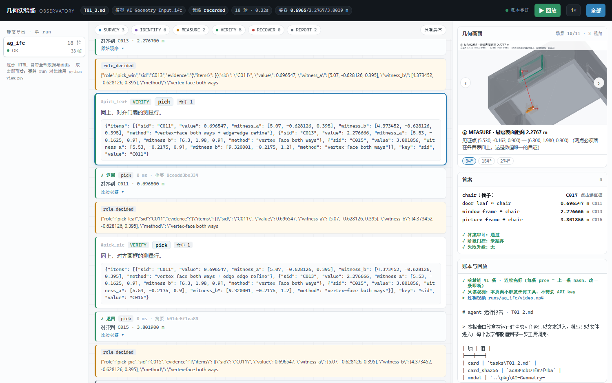

# AIGeoLab · AI 几何沙盒（Geometry Sandbox）

> 给智能体一张任务卡和一个模型文件，它自己观察、自己选工具、自己判断证据够不够、自己提交并接受审计。
> 仓库里**没有针对某道题写的代码**：题目只以文本存在，判断只以决策记录存在，数值只由几何内核产生。

参赛作品对应 **Task 01 第 2 问**：计算椅子到门扇、窗框、画框的最短表面距离并排序
（基准值 `0.696547 / 2.276666 / 3.801856 m`）。

这是一个**可观测的几何推理沙盒**，不是一份脚本：

- **编排层**（`sandbox/agent/loop.py`）把一次求解拆成 `SURVEY → IDENTIFY → MEASURE → VERIFY → REPORT`，
  外加 `RECOVER`；每个阶段只能用该阶段的工具，越界即被拒并留痕。
- **工具层**（`sandbox/tools/*`）13 个与题目无关的几何算子：读入、连通分组、主参照系、筛选、合并、
  包含、间隙、距离（带见证点）、排序、剖面、面环、提交。
- **审计层**（同一文件里的 `_audit`）提交的每个数字必须能在某次工具返回里真实出现过（1e-6 容差），
  「编一个看起来合理的数」在结构上通不过。
- **账本**（`sandbox/core/runtime.py`）哈希链逐条串起决策、调用、阶段切换与拒绝，改一条就断。

## 一分钟上手

```bash
git clone <this repo> aigeo-lab && cd aigeo-lab
pip install -r requirements.txt          # 只有 numpy + pillow；视频需要系统 ffmpeg

# 1) 取模型包，解压到 pkg/（目录结构见下）
#    https://hack26.ctrlpath.co/api/tasks/download
#    pkg/AI-Geometry-Models/{IFC,OBJ,GLTF,USD,FBX,BLEND}/...

# 2) 一条命令复现：造变体 → agent 求解（出录像）→ 对照组 → 对抗样本 → 矩阵 → 观测页
bash sandbox/reproduce.sh

# 3) 看过程（只读，不需要 API key）
python sandbox/view.py                    # 本地观测台 http://127.0.0.1:8765
python sandbox/view.py ls                 # 终端列表
python sandbox/view.py show ag_ifc        # 终端逐步时间线
python sandbox/view.py export ag_ifc      # 导出单文件 HTML，双击即看
```

**不想装环境也能看**：`docs/demo/viewer_ag_ifc.html` 是基准运行的自包含快照
（41 条账本事件 + 33 帧画面内嵌在一个文件里），双击打开，游标走一步、右侧画面跟着换。



## 与赛事要求的对应

| 赛事要求（原文要点） | 本仓库怎么满足 | 看哪里 |
|---|---|---|
| 「不能只对给定模型有效，尺寸/位置/参数改变后仍应能处理同类问题」 | 同一份决策序列，换 5 种输入各跑一遍：换格式（IFC→OBJ）、抹名称（全随机）、绕竖轴 90°、单位 ×1000、**绕竖轴 45°（非轴对齐，触发自救）**。五者答案一致（OBJ 差 1e-6，源自只保留 6 位小数） | `sandbox/compare_agent.py` → `sandbox/runs/agent_matrix.md` |
| 「AI 需要承担实际工作，不能只把单一固定算法作为完整方案」 | 决策由策略层产出（LLM / 记录回放 / 规则回退三种同一接口）；工具注册表里**不存在任何任务编号**，也没有「先选窗框再测距」的固定流程；阶段门控使 agent 不可能跳过识别直接答题 | `sandbox/agent/policy.py`、`agent/loop.py`、`tools/ops.py` |
| 「不能只给已有脚本增加 AI 对话功能」 | agent 拿到的是**观察**（几何指纹 + 命中数 + 见证点），不是脚本返回；选错工具会被门控拒，期望命中数不符会进 RECOVER 自救 | `sandbox/agent/loop.py`、`episodes/T01_2.agent.json` |
| 「用结果说明改进，说明效果、错误与局限」 | 对照组（外部 plan 驱动）与 agent 逐位一致，证明编排层无偏差；两个对抗样本分别得到 `GATE_BLOCKED` / `AUDIT_FAILED`；LLM 策略卡在哪、为什么，写在 README 里不藏 | `sandbox/README.md` → 「LLM 策略：实测到哪一步，卡在哪一步」 |
| 「代码仓库评委可读」 | 本仓库；数据与运行产物不入库（见下），代码 + 任务卡 + 决策记录 + 复现脚本全部在内 | `.gitignore` |
| 「不超过 5 分钟演示视频」 | 逐镜脚本已写好：问题 → 方法 → 五变体 → 对抗样本 → 局限 | `docs/video-script.md` |

## 仓库结构

```
README.md                 本文件：评委入口
requirements.txt          numpy / pillow（+ 可选 usd-core）
docs/video-script.md      5 分钟演示视频的逐镜脚本
docs/demo/                自包含观测页快照（免安装即可看过程）
sandbox/
  README.md               方法、机制、实测记录、已知限制（长文，建议按顺序读）
  run_agent.py            agent 入口：循环 + 留痕 + 报告 + 录像
  run.py                  plan 执行器（对照组）
  view.py                 观测层：CLI 列表 / 终端时间线 / 观测台 / 单文件导出
  agent/                  编排层（loop）、决策层（policy）、工具规格与观察压缩（schema）
  tools/                  读入层（6 格式→世界坐标网格）、度量内核、面结构、13 个工具
  core/runtime.py         哈希链账本 + 工具总线 + 引用解析（解析器不用 eval）
  tasks/T01_2.md          智能体收到的全部任务信息（不含答案、不含编号、不含步骤）
  episodes/               决策记录（可回放，无需 API key）；adv_* 是故意做坏的对抗样本
  plans/                  对照组用的 plan（只有工具调用与引用，没有控制流）
  mutate.py               造变体：换格式 / 随机化名称 / 刚体旋转 / 改单位
  compare_agent.py        泛化 + 防作弊矩阵
  viz/render.py           无头渲染（PIL 正交投影），无显卡依赖
  viz/viewer.html         观测台前端（单文件、零外部依赖）
```

## 数据与产物为什么不入库

- `pkg/`（模型包）与 `models.zip`：体积大且版权属赛方，按上面链接自行下载；
  入库会让 `git clone` 变成 40 MB+ 的搬运，也让评委难以判断「哪些是代码」。
- `sandbox/runs/`、`sandbox/variants/`、`*.mp4`、帧序列：全部可用一条命令重造，
  留着只会让 diff 变成噪声。需要给人看的过程，用 `docs/demo/` 里的自包含快照。

仓库自带的最小证据是**决策记录**（`sandbox/episodes/*.json`，几十 KB）：
它记录「当时看到什么 → 因此判断什么 → 调了什么」，没有 API key 也能逐条回放。

## 边界（写在明处）

- EDIT 层（加宽联动、拉伸切平、修正平移）、扫掠碰撞、曲面解析拟合尚未实现 —— 详见 `sandbox/README.md`。
- LLM 策略在「框体 vs 内嵌板」上卡住：窗是框+玻璃、画是框+板，题问「框」而模型选了板。
  缺的是关系判据（内环包含 + `enclosure` 配对），不是提示词。
- 本仓库只针对 Task 01 第 2 问做了端到端验证；其余 9 题是同一套工具与编排的扩展面，未逐一验收。

## 许可

MIT（见 `LICENSE`）。模型与题目版权归 CtrlPath / 赛事方所有，不在本仓库分发。
